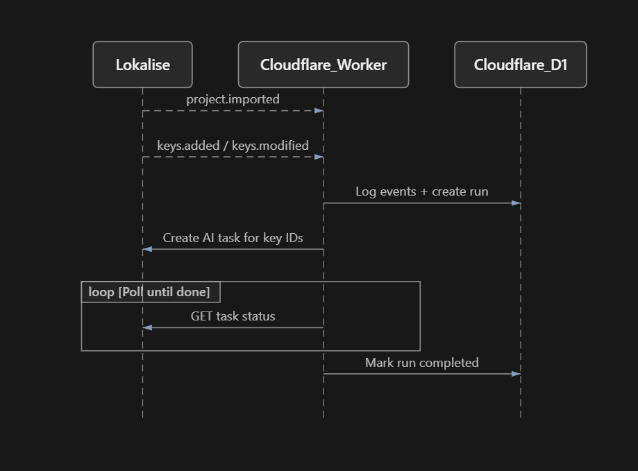
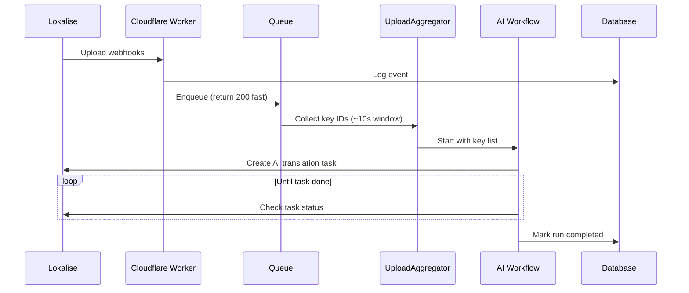

# lokalise-cf-orchestrator

## What this Cloudflare Worker does

Today, Lokalise **Workflows** are powerful for multi-step localization processes, but they do **not** support event-based triggers (for example: “when a file is imported, start AI translation automatically”).

This Worker **bridges that gap**. It listens for Lokalise **webhooks** on import, then creates an **instant AI translation task** for the new/changed keys via the Lokalise API.

| Use this when… |
| --- 
| You want AI tasks created **as soon as files are imported**
| You are building a **PoC or custom integration** with the Lokalise API
| You want a simple **audit trail** of each import → AI run

This project is a small program that runs on **Cloudflare Workers** (serverless code hosted by Cloudflare — you do not manage a server). Its job is to **watch for those imports and automate the AI translation step**.

In short, the Worker:

1. **Listens** for messages from Lokalise (“something was imported / keys changed”).
2. **Remembers** what happened in a database (so you can audit each run).
3. **Asks Lokalise** to create an AI translation task for the keys that changed.
4. **Checks back** until that task is finished.
5. **Marks the run complete** in the database.

The result: triggered with each import into Lokalise, an AI translation task is created to translate all new and modified keys, and you have a clear record of each run.

## How the pieces talk to each other

The diagram below is the high-level story. Time flows **top to bottom**. Each arrow is a message or API call between systems.



**Reading the diagram**

| Step | What happens |
| --- | --- |
| `project.imported` / `keys.added` / `keys.modified` | Lokalise sends **webhooks** (HTTP callbacks) to your Worker when an import lands or keys change. |
| Log events + create run | The Worker writes an audit record into **Cloudflare D1** (a SQL database). A “run” is one tracked import → AI cycle. |
| Create AI task for key IDs | The Worker calls the Lokalise API to create an AI translation task for the collected key IDs. |
| Loop: GET task status | The Worker repeatedly asks Lokalise whether the task is done yet (**polling**). |
| Mark run completed | When the task finishes, the Worker updates D1 so the run shows as complete. |

Under the hood the Worker also uses a few other Cloudflare tools (a queue, a short “wait window” for gathering keys, and a durable workflow for the long poll). Those details are in the sections below.


## Security basics

- **Webhook secret** — Lokalise sends an `X-Secret` header. The Worker compares it to `LOKALISE_WEBHOOK_SECRET` and returns `401` if it does not match. Pick a long random value and use the same string in Lokalise and Cloudflare.
- **API token** — `LOKALISE_API_TOKEN` is used only to call Lokalise (create/get tasks). Prefer a token with the least access your project needs for tasks.
- **Never commit secrets** — do not put tokens in git, `wrangler.toml`, or screenshots. Set them with `npx wrangler secret put …` or in the Cloudflare dashboard under **Workers → your worker → Settings → Variables and Secrets**.
- Secret **values** cannot be read back from the dashboard (only names). To rotate, put a new value over the old one.

## Troubleshooting

| Symptom | Likely cause | What to try |
| --- | --- | --- |
| Webhook returns `401 Unauthorized` | Wrong or missing `X-Secret` / `LOKALISE_WEBHOOK_SECRET` | Re-check the secret in Lokalise Webhooks and Cloudflare secrets match exactly |
| Webhook returns `Invalid JSON` | Body was mangled (common with PowerShell + `curl` quoting) | Use `Invoke-WebRequest` or `curl.exe --% …` (see Smoke test below) |
| No AI task in Lokalise | API token invalid, or no keys collected for the run | Check logs for `Invalid X-Api-Token`; confirm key webhooks use `action: import.file`; wait for the aggregation window (~10s) |
| Run stuck in `waiting` | Task still running, or poll timed out | Open the task in Lokalise; check D1 `actions` for `poll_task`; raise `task_poll_max_minutes` in KV if needed |
| Run is `skipped_empty` | Import window closed with zero collected key IDs | Confirm `project.keys.added` / `modified` fired and were not filtered out |
| Duplicate AI tasks | Same import processed twice without fingerprint match | Check `import_fingerprint` uniqueness; Workflow skips create if `lokalise_task_id` already set |
| Webhook `200` but nothing happens | Queue / aggregator / config issue | `npx wrangler tail`; confirm KV key `project:<PROJECT_ID>` exists and `"enabled": true` |

Handy commands:

```bash
npx wrangler tail
npx wrangler d1 execute lokalise_orchestrator --remote --command "SELECT id, status, lokalise_task_id, error FROM runs ORDER BY created_at DESC LIMIT 5"
```

## FAQ

**Does this translate the whole project every time?**  
No. It collects key IDs from the import-related webhooks for that upload window, then creates an AI task for **those keys only**.

**Why not use a Lokalise Workflow for this?**  
Lokalise Workflows do not currently support **event-based triggers** (such as “on file import”). This Worker uses webhooks + the Tasks API to fill that gap.

**Do I need a Cloudflare Paid plan?**  
A Free Workers account is enough to learn and run a small PoC. Heavier Durable Objects / Workflows usage may need a paid plan — check current Cloudflare limits for your account.

**Can two uploads happen at once?**  
Each Lokalise project has one aggregator actor. Uploads are handled with a short wait window and run fingerprints so a single import’s keys are batched. Overlapping imports on the same project should be tested carefully in a PoC.

**Where do I see proof it worked?**  
In Lokalise: an AI task appears and completes. In D1: the run moves to `completed` with a `lokalise_task_id`, and `actions` shows `create_task` / `poll_task` / `task_completed`.

**Does this open a pull request or update my git repo?**  
No. That is intentionally out of scope.

## Glossary

| Term | Meaning |
| --- | --- |
| **Webhook** | An HTTP request Lokalise sends to your Worker when something happens (import, keys changed). |
| **Worker** | Your program running on Cloudflare’s network — no server for you to manage. |
| **D1** | Cloudflare’s SQL database used here as a ledger of events and runs. |
| **Key / key ID** | A single translatable string in Lokalise; the numeric ID is what the AI task targets. |
| **Run** | One tracked cycle: import detected → AI task → done (or failed). |
| **Polling** | Asking “is it done yet?” on a timer instead of waiting for a completion webhook. |
| **Secret** | A private value (API token or webhook password) stored encrypted in Cloudflare, not in source code. |
| **KV config** | Per-project JSON settings (languages, timing, enabled flag) stored in Cloudflare KV. |
| **Aggregation window** | A short delay (often ~10 seconds) to collect all key webhooks from one import before creating the AI task. |

---

# Build this service yourself

This section is for engineers who want to **recreate or fork** the same architecture. Clone this repo or start empty and mirror the pieces below.

## What you will build

An event-driven pipeline:

1. Lokalise webhook → Worker (auth + log + enqueue)
2. Queue → Durable Object (collect key IDs for ~10s)
3. Durable Object alarm → Cloudflare Workflow
4. Workflow → Lokalise API (create AI task + poll until done)
5. D1 stores the audit trail the whole way

**Design rule:** never call the Lokalise API inside the webhook HTTP handler. Validate → write `events` → enqueue → return `200`. Long work belongs in Queue / Durable Object / Workflow.



## Prerequisites

- Cloudflare account + [Wrangler](https://developers.cloudflare.com/workers/wrangler/)
- Node.js 20+
- Lokalise project + API token that can create tasks
- A webhook secret you choose (shared with Lokalise)

```bash
node -v
npm install
npx wrangler login
```

## Cloudflare building blocks

| Binding / resource | Role in this service |
| --- | --- |
| Worker (`src/index.ts`) | `GET /health`, `POST /webhooks/lokalise`, `queue()` consumer |
| Queue `INBOUND_QUEUE` | Async inbox so webhooks stay fast |
| Durable Object `UPLOAD_AGGREGATOR` | One instance per `projectId`; aggregation window |
| Workflow `TRANSLATE_WORKFLOW` | Create AI task + poll (can sleep for minutes) |
| D1 `DB` | Tables: `events`, `runs`, `run_keys`, `actions` |
| KV `CONFIG` | Per-project JSON (`project:<PROJECT_ID>`) |
| Secrets | `LOKALISE_API_TOKEN`, `LOKALISE_WEBHOOK_SECRET` |

Export the Durable Object and Workflow **classes from the Worker entrypoint** (`src/index.ts`). Cloudflare will not deploy them otherwise.

## Repo layout to implement

```text
lokalise-cf-orchestrator/
  wrangler.toml
  config.project.json
  migrations/0001_init.sql
  src/
    index.ts                  # fetch + queue; export DO + Workflow
    types.ts                  # Env + message types
    webhook.ts                # X-Secret, insert events, enqueue
    upload-aggregator.ts      # Durable Object
    lokalise-client.ts        # Lokalise REST (tasks)
    workflows/translate-ai.ts # WorkflowEntrypoint
```

| File | Build this to… |
| --- | --- |
| `webhook.ts` | Compare `X-Secret`; accept empty ping with `200`; parse JSON; `INSERT` into `events`; `INBOUND_QUEUE.send` |
| `index.ts` `queue()` | Route each message to `UPLOAD_AGGREGATOR.idFromName(projectId)` → `handleEvent` |
| `upload-aggregator.ts` | On `project.imported` create a `runs` row; on `keys.*` with `action === "import.file"` collect IDs; on alarm start the Workflow |
| `lokalise-client.ts` | `POST /projects/{id}/tasks` with `task_type: automatic_translation`; `GET` task status |
| `workflows/translate-ai.ts` | Load KV config; create task (skip if already created); poll; mark `completed` / `failed` |

## Step-by-step setup

### 1. Create Cloudflare resources

```bash
npx wrangler d1 create lokalise_orchestrator
npx wrangler kv namespace create lokalise_config
npx wrangler queues create lokalise-inbound-events
```

Paste the D1 `database_id` and KV `id` into `wrangler.toml`.

Wire bindings like this project:

- `[[d1_databases]]` → `DB`
- `[[kv_namespaces]]` → `CONFIG`
- `[[queues.producers]]` + `[[queues.consumers]]` → `lokalise-inbound-events`
- `[[durable_objects.bindings]]` → `UploadAggregator` + `[[migrations]]` with `new_sqlite_classes`
- `[[workflows]]` → `TranslateAiWorkflow`

**Tip:** add the queue **consumer** only after `queue()` exists in `index.ts`, or deploy fails with “Queue handler is missing”.

### 2. Apply the D1 schema

```bash
npx wrangler d1 migrations apply lokalise_orchestrator --remote
```

Schema lives in `migrations/0001_init.sql` (`runs`, `events`, `run_keys`, `actions`).

### 3. Set secrets

```bash
npx wrangler secret put LOKALISE_API_TOKEN
npx wrangler secret put LOKALISE_WEBHOOK_SECRET
```

`secret put` updates the live Worker immediately (no redeploy required for secrets alone).

### 4. Write per-project KV config

Key: `project:<LOKALISE_PROJECT_ID>`

```json
{
  "enabled": true,
  "source_lang": "en",
  "target_langs": ["es"],
  "aggregation_window_ms": 10000,
  "task_poll_max_minutes": 30
}
```

```bash
npx wrangler kv key put --binding=CONFIG "project:YOUR_PROJECT_ID" --path=./config.project.json --remote
```

### 5. Deploy and connect Lokalise

```bash
npx wrangler deploy
curl https://YOUR_WORKER.workers.dev/health
```

In Lokalise: **Apps → Webhooks**

- URL: `https://YOUR_WORKER.workers.dev/webhooks/lokalise`
- Secret: same as `LOKALISE_WEBHOOK_SECRET`
- Events: `project.imported`, `project.keys.added`, `project.keys.modified`

## Implement the pipeline (behavior contract)

Build in this order so each stage is testable.

### A. Health + webhook ingress

- `GET /health` → `{ "ok": true }`
- Webhook: `401` on bad secret; `200` on empty ping; insert `events`; enqueue; return `200` quickly

### B. Upload aggregator (Durable Object)

- DO id from `projectId` (`idFromName`)
- `project.imported` → create `runs` with status `aggregating`, fingerprint `filename|timestamp|branch`, schedule alarm for `aggregation_window_ms`
- `project.keys.added` / `project.keys.modified` → only if `action === "import.file"`; append key IDs
- After a run closes, clear buffers so the next import cannot reuse old key IDs
- On alarm: status `ready` (or `skipped_empty`); if ready, `TRANSLATE_WORKFLOW.create({ id: translate-${runId}, params })`

### C. AI Workflow

- Load KV `project:<id>`; fail permanently if missing/disabled (`NonRetryableError` from `cloudflare:workflows`)
- If run already has `lokalise_task_id` / is `waiting`, skip create and poll that task
- Else create Lokalise AI task; set `waiting`; write `actions.create_task`
- Poll: first sleeps ~15s, then ~1m; cap with `task_poll_max_minutes`
- Terminal OK: `completed` / `closed` → mark D1 `completed`
- Terminal bad / timeout → mark `failed`

### Run status machine

`aggregating` → `ready` → `task_creating` → `waiting` → `completed`  
Also: `skipped_empty`, `failed`

## Smoke test

Import a file in Lokalise (or POST a test webhook). On PowerShell, prefer:

```powershell
Invoke-WebRequest -Uri "https://YOUR_WORKER.workers.dev/webhooks/lokalise" `
  -Method POST `
  -Headers @{ "X-Secret" = "YOUR_WEBHOOK_SECRET" } `
  -ContentType "application/json" `
  -Body '{"event":"project.keys.added","action":"import.file","project":{"id":"YOUR_PROJECT_ID"},"keys":[{"id":101}]}'
```

Watch and query:

```bash
npx wrangler tail

npx wrangler d1 execute lokalise_orchestrator --remote --command \
  "SELECT id, status, lokalise_task_id, error, updated_at FROM runs ORDER BY created_at DESC LIMIT 5"

npx wrangler d1 execute lokalise_orchestrator --remote --command \
  "SELECT action, detail_json, created_at FROM actions ORDER BY id DESC LIMIT 20"
```

**Success:** run reaches `completed`, Lokalise shows the AI task, `actions` includes `create_task` / `poll_task` / `task_completed`.

## Builder checklist

- [ ] D1 + KV + Queue created; IDs in `wrangler.toml`
- [ ] Migrations applied remotely
- [ ] Both secrets set
- [ ] KV `project:<id>` written and `enabled: true`
- [ ] DO + Workflow classes exported from `src/index.ts`
- [ ] Lokalise webhook subscribed to import + key events
- [ ] E2E: import → AI task → D1 `completed`

## Official docs

- [Workers](https://developers.cloudflare.com/workers/) · [Queues](https://developers.cloudflare.com/queues/) · [Workflows](https://developers.cloudflare.com/workflows/) · [D1](https://developers.cloudflare.com/d1/) · [KV](https://developers.cloudflare.com/kv/) · [Durable Objects](https://developers.cloudflare.com/durable-objects/)
- [Lokalise webhooks](https://developers.lokalise.com/docs/webhooks) · [Create a task](https://developers.lokalise.com/reference/create-a-task)
